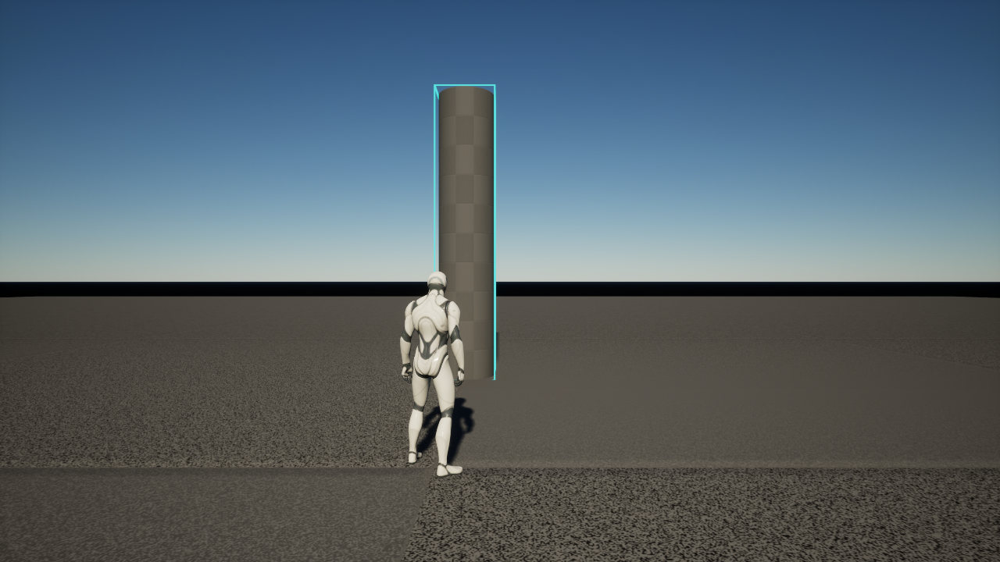

# LevelControl

**在运行中的 Unreal Engine 游戏里，用自然语言设计和建造关卡。**

LevelControl 是一个本机 AI 关卡设计助手。桌面气泡窗口连接正在运行的 UE5 游戏，把对话交给本机 Codex CLI 或 Claude Code，再通过一组 MCP 工具完成实体创建、选择、查询、预览、提交与撤销。设计层用确定性的 LGG 语法把自然语言计划编译成普通运行时事务；演出层用统一的向上生长动画把建造结果呈现给玩家。

它不是编辑器里的"一键生成资产"，而是**游戏已经在跑**的前提下，把一次对话变成一次可回执、可撤销、可观测的世界事务。



## 核心功能

- **语音优先的桌面气泡**：F8 按住说话，参考图可直接拖入；断线不自动重发操作，审批与提问由气泡转交用户；深浅主题、悬浮球、自定义形象。
- **双 Agent 后端**：Codex app-server 与 Claude Code stream-json 两条原生接入；模型与思考强度按当前 Agent 的能力列表动态列出，下一条消息生效，不改写原生配置与凭据。
- **17 个 MCP 工具**：`lc.connect`、`lc.help`、`lc.read`、`lc.edit`、`lc.query`、`lc.changes`、`lc.annotate`、`lc.capture`、`lc.context`、`lc.receipt`、`lgg_knowledge`、`lgg_card`、`lgg_draft`、`lgg_run`、`lgg_build`、`lgg_plan`、`lgg_module`。
- **LGG 构建 DSL**：`lgg_plan` 先交粗粒度模块布局，`lgg_module` 逐模块落地，最后一个模块自动合并为一次世界事务；也可以 `lgg_build` 一次成型。米 + Z-up 只在编译器边界换算为 UE 的厘米，实体 ID 由设计路径确定派生，重命名不影响身份。
- **语义核心（协议 4）**：稳定的持久实体身份、结构化查询（角色/区域/包围盒/邻近/关系/分页）、`view_left` 冻结查询瞬间的玩家视角、120 秒选择令牌、可恢复的增量 `changes`、可撤销的语义标注。
- **向上生长演出**：按真实几何差量而不是对象数量选择 3/4/5 秒的显现；自动安排总览、逐模块与主机位镜头，中文标注，音乐节拍量化，可在演出中跳过并归还控制。
- **工程验证体系**：离线 pytest、UE Automation、真实 Shipping 包 HTTP 回归、30 分钟真实对话 soak、10k 实体性能测量都留有机器记录。

## 技术架构

四层边界，层与层之间只通过 JSON / HTTP 或工具契约通信：

```
01 对话层   Codex / Claude Code → 只认 lc.* / lgg_* 工具
02 设计层   tools/lc + tools/lgg（Python）→ 只认 HTTP，不认 UE 类型
03 实体层   ue/Plugins/LevelControlRuntime（C++）→ 不知道 LGG，也不知道 MCP
04 演出层   tools/presenter + UE 呈现 → 只消费交接事件与时间轴
```

| 目录 | 职责 |
|---|---|
| `tools/lc/` | MCP 服务器、唯一的 HTTP 写入口 `lc.client`、命令解析、项目/会话/模型适配、PySide6 桌面气泡 |
| `tools/lgg/` | 确定性关卡语法：schema、编译器、构造器、设计卡服务、知识案例检索 |
| `tools/presenter/` | 演出策略：显现选择、时间轴、节拍分析、机位规则 |
| `tools/checks/` | 基于运行时真实碰撞的行走图、跳跃与净空检查 |
| `ue/Plugins/LevelControlRuntime/` | UE 5.8 C++ 插件：回环 HTTP、事务与回执、SQLite 持久化、语义读模型、线框与演出 |
| `project/` | `ProjectLC.uproject`、Config、游戏模块源码，以及随工程分发的游戏内 Agent 契约（≤2k token） |
| `tests/` | 283 项离线 Python 测试，以及延迟、soak、真实包回归的驱动脚本 |
| `docs/` | 协议、架构、语义核心、性能记录与产品内 `lc.help` 正文 |

## 关键技术实现

### 单一写入口与幂等事务

所有世界修改都必须经过 `lc.client` → 回环 HTTP → `ULCTxService`。写请求带 `req_id`，重复提交返回同一回执；失败也返回结构化结果而不是裸错误，让 Agent 能读懂"哪里没通过"。预览与正式提交走不同通道：预览不进实体索引、不写修改记录，中途打断只需丢弃。破坏性操作执行前自动保存检查点，撤销以事务为单位。

### 实体身份与语义查询

Agent 永远看不到 Actor 名、指针或索引——它们会在重建后漂移。设计层只使用稳定 ID（`<scene>-<area:02d>-<module:02d>-<part:02d>`）与 kebab-case 语义名；用户口语名写成别名。协议 4 的 `lc.query` 支持角色、区域、模式、包围盒、邻近、关系、排序与 32–256 条分页，`view_left` 会冻结查询瞬间的镜头，投影歧义或遮挡候选返回 `ambiguous` 且不能生成写令牌。选择令牌固定 ID、世界版本与叶节点指纹，120 秒过期。

### LGG 确定性编译

自然语言计划先成为设计文档，再由 `tools/lgg` 编译为普通事务实体：相同输入必然得到相同 ID，数组展开带 `members` 键，`repeat` 只允许 `step` 或 `span` 二选一，构造器（地面、墙、柱廊、门洞、楼梯、喷泉）只使用固定槽位以保持身份。编译器是唯一处理"米 + Z-up ↔ UE 厘米 + Z-up"的边界，避免坐标手性在层间扩散。

### 运行时性能与分帧预算

引擎侧硬约束：单批 ≤16,384 个实体；生成分帧，每帧应用预算 ≤2 ms；线框与高亮使用自建 `PrimitiveComponent`/`SceneProxy`，不用会被 Shipping 编译掉的 `DrawDebug*`。实测中最慢的单实体应用为 4.92 ms，快速构建的最大单帧应用为 1.10 ms，30 分钟 soak 中没有一帧超过 100 ms。

### 双 Agent 接入与能力开关

气泡只负责对话，不实现第二套 Agent 运行时。Codex 走 app-server，Claude 走原生 CLI 的 stream-json；两者的模型、思考强度、技能与权限都留在原生配置里。3.2 增加插件、技能、工作流、外部 MCP 四类总开关（默认关闭），验证过"隐藏目录/写空 MCP 表"不足以真正禁用，必须按 Agent 的实际启动参数生效。LevelControl 自身的 MCP 始终保留。

## 实测数据

以下数字来自开发机的工程验证记录，覆盖不同版本与不同硬件条件，用于说明量级而非横向基准。

| 场景 | 结果 |
|---|---|
| 离线 Python 测试 | **283 passed / 127 skipped**（6.85 s） |
| UE Automation | 单版本最多 **13 项**（事务、撤销、生长、短演出） |
| 自然语言创建 + 撤销（W1） | 20/20 成功；p50 **6.23 s**、p90 **8.37 s**；撤销回执 **97.7 ms** |
| 快速构建 `lgg_build` | **30/30 成功**；p50 **15.50 s**、p95 **22.36 s**（旧工具链单次 187.63 s） |
| 10k 实体 | 5×2000 构建共 **28.98 s**；编辑帧 p95 **13.37 ms**；摘要查询 **100.5 ms** |
| 30 分钟真实对话 soak | **1802.56 s**、40/40 用例、293,494 帧；帧 p95 **8.18 ms**、0 帧 >100 ms |
| 向上生长演出 | 149 实体；帧 p95 **7.75–8.18 ms**；单次呈现更新 ≤0.42 ms |

## 仓库结构

```
.
├─ tools/           Python 工具链（lc / lgg / presenter / checks）
├─ ue/              UE 5.8 插件源码与原创音频资源
├─ project/         UE 工程文件、Config、游戏模块源码、游戏内 Agent 契约
├─ scripts/         环境恢复、构建、打包、素材生成的脚本
├─ tests/           pytest 测试与延迟/soak 基准驱动
├─ docs/            协议、架构、语义核心、性能、产品内帮助
└─ pyproject.toml
```

仓库刻意**不包含**：UE 引擎、角色模板与语音模型、`Binaries`/`Intermediate`/`Saved`、打包后的游戏与第三方运行时。白盒资产只保留自建的最小集合（`project/Content/LC2` 与 `LC_Empty`，约 4 MB），角色模板与原创配乐都可以由 `scripts/create_*.py` 重建；完整运行需要本机 UE 5.8 工程与已构建的游戏。

## 本地开发

```powershell
python -m venv .venv
.venv\Scripts\python -m pip install -e ".[dev,desktop]"
$env:PYTHONPATH="$PWD\tools"
.venv\Scripts\python -m pytest -q -m "not live"
.venv\Scripts\python -m ruff check tools tests
```

`live` 标记的测试需要一个正在运行的可丢弃 ProjectLC 实例；仓库中的离线测试使用 fake app-server / CLI 与内存替身，不调用真实模型。

## 已知边界

- 语义核心尚未 GA：10k 量级下实体注册/移除仍是 O(n²)，每次提交做全量重排；ISM 卸载重载后的持久 ID 映射尚未复验。
- 六个 LGG 知识案例仍是候选，等待人工审核；产品内帮助会明确标注。
- 真实模型、语音与游戏内 UI 的最终用户验收仍需在目标机器上执行；合并后的 3.2 包已通过 Shipping 编译、Cook 与文件级校验。
- 仓库只含自建白盒与原创音频，不含《艾尔登法环》资产、Smithbox 导出或 AIVA 曲目；第三方组件的许可清单见 [docs/第三方与资源说明.md](docs/第三方与资源说明.md)。

## English Overview

LevelControl is a local, voice-first level design assistant for a **running** Unreal Engine 5 game. A desktop bubble connects to the game over loopback HTTP and hands the conversation to a local Codex CLI or Claude Code. The agent works exclusively through 17 MCP tools that create, select, query, preview, commit and undo world transactions. A deterministic level grammar (LGG) compiles natural-language plans into ordinary runtime entities with stable IDs, and a presentation layer reveals the result with a single upward-growth animation, automatic cameras and captions.

The repository contains the UE 5.8 C++ plugin (transactions, receipts, SQLite persistence, semantic read model), the Python toolchain (MCP server, LGG compiler, presenter, geometry checks), the PySide6 companion, the pytest suite and the engineering validation records. It intentionally excludes engine content, cooked game builds and third-party runtimes. Code is MIT licensed; all 3D assets are self-made whitebox and the music is project-original.

## License

[MIT](LICENSE) © 2026 hou

游戏引擎、第三方组件与其资源不在此许可范围内，详见 [第三方与资源说明](docs/第三方与资源说明.md)。
